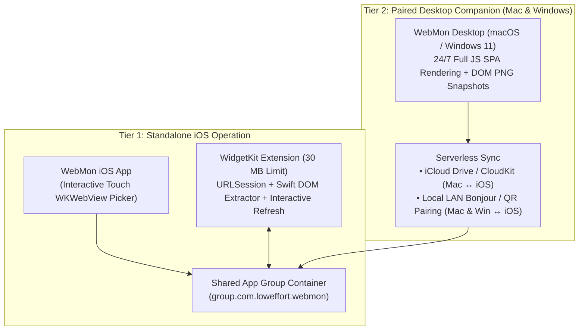

# WebMon for iOS — Home Screen & Lock Screen Widgets Feasibility & Constraints Report

> [!IMPORTANT]
> **Executive Verdict**:
> 1. **Can we build an iOS app that displays `WebMon` widgets on the Home Screen and Lock Screen?** **Yes.** Nearly all of `WebMon`'s data models (`WebComponentWidgetDefinition`, `SelectedDOMComponent`, `StoredCredentialProfile`) and SwiftUI Telemetry Card views (`WebWidgetCardView`, 8 graph styles, `WM` monogram badges) can be shared directly with an iOS 17+ / 18+ target and a **WidgetKit Extension**.
> 2. **Standalone vs. Paired with Desktop (`WebMon` for Mac/Windows)?** A **Hybrid Architecture (Standalone-capable + Optional Desktop Companion Sync/Relay)** is strongly recommended. A purely standalone iOS app works well for server-rendered HTML, JSON/API endpoints, and foreground/on-tap DOM refreshes, but **pairing with the desktop installation unlocks 24/7 background JavaScript SPA rendering, visual DOM snapshots (`WKWebView` / `WebView2` screen captures), and access to `localhost`/internal corporate dashboards**.

---

## 1. How Home Screen vs. Lock Screen Widgets Work on iOS

Unlike macOS (`NSPanel`) and Windows 11 (`WPF + WebView2`), **iOS WidgetKit does not run a live, persistent `WKWebView` inside a Home Screen or Lock Screen widget**. Instead, WidgetKit archives a static SwiftUI view hierarchy on a timeline.

To support every `WebMon` use case on iOS, widgets operate in two complementary presentation modes:

| Widget Location | Supported WidgetKit Families | How `WebMon` Renders Content |
| :--- | :--- | :--- |
| **Home Screen & Today View** | `.systemSmall`, `.systemMedium`, `.systemLarge` | **Mode 1 — Native Telemetry Card (8 Graph Styles)**: Displays extracted metric value, unit, HTTP status, latency (`ms`), and sparkline/bar/ring chart using shared SwiftUI code. **Mode 2 — Full-Bleed Visual DOM Snapshot**: Displays a cropped high-DPI PNG snapshot of the isolated DOM component (`#cluster-status-card`, Grafana chart, etc.), with optional Header/Footer toggle or **100% Full-Card edge-to-edge bleed**. |
| **Lock Screen** | `.accessoryCircular`, `.accessoryRectangular`, `.accessoryInline` | **Native Telemetry Card / Gauge Only**: iOS forces Lock Screen widgets into `.vibrant` monochrome/tinted rendering. Website screenshots are illegible here, whereas `WebMon`'s extracted numeric value, sparkline, tachometer ring, and `WM` badge render natively and crisply. |
| **StandBy Mode & Apple Watch** | `.systemSmall` (StandBy), `.accessoryRectangular` | Full-color Night Mode telemetry cards in iOS StandBy when charging horizontally, plus Lock Screen complication styles. |
| **Dynamic Island & Lock Screen Banner** | `ActivityKit` (`LiveActivity`) | Optional real-time pinned banner for active incidents or deployments requiring frequent updates. |

---

## 2. Standalone iOS vs. Desktop-Paired Comparison

| Capability | Standalone iOS Only | Paired with Desktop Only | **Hybrid: Standalone + Desktop Pairing (Recommended)** |
| :--- | :--- | :--- | :--- |
| **Select DOM Components** | Touch-based interactive browser picker on iPhone/iPad (`tap` to select DOM node) | Select on Mac/Windows desktop | Select on **either** desktop or iPhone; widget definitions sync automatically |
| **Server-Rendered (SSR) HTML & Status Pages** | **Full support** (WidgetKit fetches HTML via `URLSession` and extracts selector text/numbers) | Full support | **Full support** |
| **Client-Side JS SPAs (React, Grafana, Datadog)** | **Limited in background**: requires `WKWebView` JS execution, which only runs reliably in foreground or brief `BGAppRefreshTask` windows | **Full 24/7 support**: Desktop `WKWebView`/`WebView2` evaluates JS continuously and pushes extracted values + PNG crops | **Full support** when desktop is awake; falls back to last snapshot or on-tap refresh when away |
| **Visual DOM Screenshot Widgets (Full-Bleed)** | Updated when iOS app opens or user taps "Snapshot Refresh" | Updated continuously by desktop renderer | Updated continuously by desktop + on-demand on iOS |
| **`localhost:3000` & Internal VPN Dashboards** | Fails when iPhone is not on the dev machine / corp LAN | Works whenever desktop is on the network | Works via desktop relay |
| **Zero Cloud Server Cost** | 100% on-device | 100% local / iCloud | **100% serverless** (uses user's iCloud + LAN mDNS) |

---

## 3. Critical iOS Constraints & Caveats

> [!WARNING]
> Below are the **6 hard iOS operating system constraints** imposed by Apple's sandbox, WidgetKit, and Jetsam memory manager, along with how `WebMon for iOS` must be engineered around them.

### Constraint 1: WidgetKit's 30 MB Jetsam Memory Ceiling (No `WKWebView` in Widget Extension)
- **The Caveat**: iOS allocates only **~30 MB of RAM** to a WidgetKit TimelineProvider extension. Instantiating a `WKWebView` inside the Widget Extension process will either fail to attach to WebKit's GPU process in the background or immediately trigger a Jetsam `EXC_RESOURCE` crash.
- **Engineering Solution**:
  - **Inside the Widget Extension**: Never instantiate `WKWebView`. Instead, run a lightweight `URLSession` fetch + fast Swift DOM/CSS selector parser (`SwiftSoup` or lightweight regex/tree extractor) for text/numeric telemetry, and read pre-rendered PNG snapshots from the shared App Group container (`group.com.loweffort.webmon`).
  - **Inside the Main iOS App (or Paired Desktop App)**: Perform full `WKWebView` JavaScript SPA rendering and `takeSnapshot(with:)` image cropping, writing the resulting `<150 KB` compressed JPEG/PNG into the shared App Group folder and calling `WidgetCenter.shared.reloadTimelines(ofKind:)`.

### Constraint 2: Refresh Cadence Throttling (No 5-Second Background Timer)
- **The Caveat**: On macOS and Windows, `WebMon` can refresh widgets every `5s`–`30s` indefinitely. On iOS, `TimelineProvider` background reloads are budgeted by SpringBoard to roughly **every 15 to 30 minutes** (40–70 times per day). `BGAppRefreshTask` is similarly opportunistic based on battery and usage patterns.
- **Engineering Solution**:
  - **iOS 17+ Interactive Widget Button (`AppIntent`)**: Add a native `↻` button directly onto the Home Screen widget header or corner pill using `Button(intent: RefreshWebWidgetIntent(widgetId:))`. When the user taps `↻` on their Home Screen, iOS wakes the `AppIntent` immediately, fetches fresh data, and redraws the widget in place (~0.5s–1.5s) **without opening the app and without counting against the background timeline budget**.
  - **Honest UI Labeling**: In the iOS UI, label background intervals as *"Background Sync: ~15m (iOS System Managed) + Instant Tap Refresh"* so users understand iOS battery rules.

### Constraint 3: Lock Screen Rendering Mode (`.vibrant` Monochrome)
- **The Caveat**: iOS Lock Screen widgets (`.accessoryCircular`, `.accessoryRectangular`, `.accessoryInline`) do not allow full-color arbitrary images; iOS applies a luminance/alpha vibrant tint filter. A raw screenshot of a webpage looks like a solid white/gray rectangle on the Lock Screen.
- **Engineering Solution**:
  - Lock Screen widgets automatically use **`WebMon` Telemetry Card Mode** (`extractedNumericValue`, `extractedUnit`, `lastExtractedSummary`, `valueHistory` sparkline, and `WM` badge), which is vector-rendered by SwiftUI and looks first-party on the iOS Lock Screen and StandBy.

### Constraint 4: Touch-Based DOM Component Picker UX on Mobile Screens
- **The Caveat**: On desktop, `WebMon`'s DOM picker relies on `mousemove` hover bounding boxes (`__loweffort_ww_overlay`) and clicking to select. On iOS, there is no mouse hover, and tapping a link normally navigates away.
- **Engineering Solution**:
  - In **Picker Mode** on iOS (`window.__lowEffortPickerEnabled = true`):
    - **Single Tap** highlights and previews the tapped DOM element's bounding box, tag, and selector in a bottom drawer (`[+ Add Parent] [+ Add to Basket]`) while suppressing navigation (`e.preventDefault()`).
    - **Desktop Sync Shortcut**: Users who prefer picking complex selectors on a 27" monitor can pick them in `WebMon` on macOS or Windows and have the widget definition appear automatically on their iPhone.

### Constraint 5: Keychain & Cookie Sharing Across App, Widget Extension & Locked Device
- **The Caveat**: By default, iOS Keychain items created with `kSecAttrAccessibleWhenUnlocked` cannot be read when the iPhone is locked (e.g., when a Lock Screen widget refreshes while the screen is on at the Lock Screen). Additionally, `WKWebsiteDataStore.default()` cookies are sandboxed to the main app process.
- **Engineering Solution**:
  - Use a shared **Keychain Access Group** with `kSecAttrAccessibleAfterFirstUnlockThisDeviceOnly` so background/Lock Screen refreshes can read Bearer tokens, Basic Auth credentials, and session cookies even before Face ID unlock.
  - Synchronize authenticated session cookies from `WKHTTPCookieStore` into `HTTPCookieStorage.sharedCookieStorage(forGroupContainerIdentifier: "group.com.loweffort.webmon")` so `URLSession` inside the Widget Extension inherits the user's logged-in session automatically.

### Constraint 6: Distribution & Code Signing Caveat (Apple Developer Program Required)
- **The Caveat**: Unlike macOS (where users can download `WebMon.dmg` directly from GitHub Releases) and Windows 11 (`WebWidget-Setup.exe`), iOS apps with **App Groups (`group.com.loweffort.webmon`)** and **WidgetKit Extensions** require provisioning profiles signed by a paid **Apple Developer Program ($99/yr)** account and distribution via **TestFlight / App Store** (or AltStore/SideStore for sideloading).

---

## 4. Recommended Architecture for `WebMon for iOS`

1. **Shared Multiplatform Core (`WebMonKit` / `Sources/Shared`)**:
   - Share `WebWidgetModels.swift`, `CustomWidgetModels.swift`, `WebCardModels.swift`, `WebComponentScripts.swift`, and the 8 SwiftUI Telemetry Card chart views (`WebWidgetCardView`, `WebRateGridChart`) across **macOS** and **iOS**.
2. **Standalone + Paired Hybrid Sync**:
   - **Standalone**: Full in-app `WKWebView` touch component picker, Keychain Auth Vault, interactive Home Screen tap-to-refresh (`AppIntent`), and background `URLSession` DOM polling.
   - **Paired with Desktop (macOS & Windows 11)**:
     - **macOS ↔ iOS**: Automatic widget config + rendered DOM snapshot sync via iCloud (`group.com.loweffort.webmon` / iCloud Drive folder).
     - **Windows 11 / macOS ↔ iOS**: 1-click QR Code / Local Network sync (`http://<desktop-lan-ip>:49152/webmon-sync`) so desktop-rendered SPA snapshots and widget baskets transfer to iOS in one tap.

---

## 5. Next Steps / Decisions

If you'd like to proceed once the `WebMon` rename thread completes:
1. Should we add the **iOS App + WidgetKit Extension (`iOS/` target / Xcode project)** inside the unified `WebMon` repository so it shares models and card views directly with the macOS app?
2. Which Desktop-to-iOS pairing transport should we prioritize first alongside Standalone mode: **iCloud Drive sync**, **Local LAN / QR code sync** (works with both Windows & Mac), or **both**?
