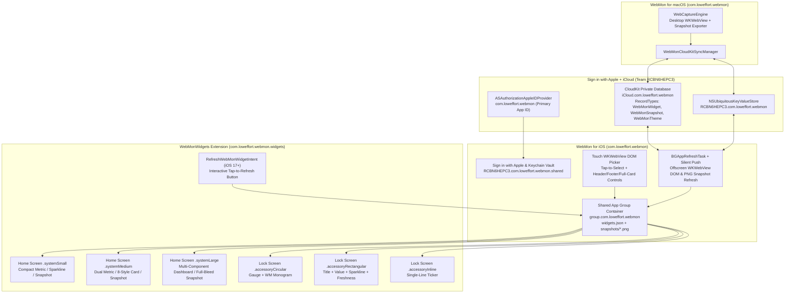

# WebMon for iOS & CloudKit — Apple Developer Provisioning & Implementation Plan

> [!IMPORTANT]
> **Automated App Store Connect API Provisioning Completed (Team `RCBN6HEPC3`)**
> Using your local App Store Connect API Key (`YL73A53RL3` / Issuer `aa1ce9a0-d6d5-4d12-8825-cd1bfaa0a39b`), we have **already registered both Bundle IDs, enabled their capabilities, and generated & installed all 5 Provisioning Profiles** into `~/Library/MobileDevice/Provisioning Profiles/`.

---

## 1. Provisioned Apple Developer & App Store Connect Identifiers

All identifiers below are standardized on the new **`WebMon`** product identity (`com.loweffort.webmon`) for Team **`RCBN6HEPC3` (`James Humphrey`)**:

| Resource Type | Exact Identifier | ASC Resource ID | Platform | Status |
| :--- | :--- | :--- | :--- | :--- |
| **Primary App Bundle ID** (macOS & iOS App) | `com.loweffort.webmon` | `X5LN5398D5` | `UNIVERSAL` | **Created via API (`HTTP 201`)** |
| **WidgetKit Extension Bundle ID** (iOS Home/Lock/StandBy) | `com.loweffort.webmon.widgets` | `T3GYJVM8K8` | `UNIVERSAL` | **Created via API (`HTTP 201`)** |
| **Sign in with Apple** (`APPLE_ID_AUTH`) | `com.loweffort.webmon` (Primary App Consent) | `X5LN5398D5_APPLE_ID_AUTH` | iOS / macOS | **Enabled via API (`HTTP 201`)** |
| **iCloud & CloudKit** (`ICLOUD` / `XCODE_6`) | `iCloud.com.loweffort.webmon` | `X5LN5398D5_ICLOUD` & `T3GYJVM8K8_ICLOUD` | iOS / macOS / WidgetKit | **Capability Enabled via API (`HTTP 201`)** |
| **App Groups** (`APP_GROUPS`) | `group.com.loweffort.webmon` | `X5LN5398D5_APP_GROUPS` & `T3GYJVM8K8_APP_GROUPS` | iOS / macOS / WidgetKit | **Capability Enabled via API (`HTTP 201`)** |
| **Push Notifications** (`PUSH_NOTIFICATIONS`) | `com.loweffort.webmon` (`aps-environment`) | `X5LN5398D5_PUSH_NOTIFICATIONS` | iOS / macOS | **Enabled via API (`HTTP 201`)** |
| **Shared Keychain Group** | `RCBN6HEPC3.com.loweffort.webmon.shared` | Wildcard `RCBN6HEPC3.*` | iOS / macOS / WidgetKit | **Active in Profiles** |
| **iCloud Key-Value Store** | `RCBN6HEPC3.com.loweffort.webmon` | Wildcard `RCBN6HEPC3.*` | iOS / macOS / WidgetKit | **Active in Profiles** |

### Installed Provisioning Profiles (`~/Library/MobileDevice/Provisioning Profiles/` & `~/.appstoreconnect/signing/webmon-20261106/`)

| Profile Name | Type | UUID | Signing Certificate | Registered Devices |
| :--- | :--- | :--- | :--- | :--- |
| `WebMon iOS App Store 2026-11-06` | `IOS_APP_STORE` | `a520e944-fd20-46cf-bf38-01ab0238fb92` | `Apple Distribution: James Humphrey (RCBN6HEPC3)` (`54CNK2LW27`) | App Store / TestFlight |
| `WebMon Widgets iOS App Store 2026-11-06` | `IOS_APP_STORE` | `1eb06dcf-10f9-4980-9ae8-b9e75344347e` | `Apple Distribution: James Humphrey (RCBN6HEPC3)` (`54CNK2LW27`) | App Store / TestFlight |
| `WebMon iOS Development 2026-11-06` | `IOS_APP_DEVELOPMENT` | `55533b10-8d22-4aec-bc1d-bc6d35993915` | `Apple Development: Created via API (YL73A53RL3)` (`6G8QUGM66T`) | `Johns iPhone`, `Jims iPhone` |
| `WebMon Widgets iOS Development 2026-11-06` | `IOS_APP_DEVELOPMENT` | `ed0e6354-4687-45d3-b8b6-b85b4c6a3ad9` | `Apple Development: Created via API (YL73A53RL3)` (`6G8QUGM66T`) | `Johns iPhone`, `Jims iPhone` |
| `WebMon Mac App Store 2026-11-06` | `MAC_APP_STORE` | `95f3e449-9705-4f39-b76b-c3b5220bef49` | `Apple Distribution: James Humphrey (RCBN6HEPC3)` (`54CNK2LW27`) | Mac App Store |

---

## 2. Quick Portal Checklist for Your App Store Connect / Developer Session

Because Apple's public REST API v1 turns on the `APP_GROUPS` and `ICLOUD` capability switches on a Bundle ID (`X5LN5398D5` and `T3GYJVM8K8`) but does not expose a REST endpoint to create/check specific named container strings, perform these **3 quick steps** when you open your Apple Developer / App Store Connect session:

1. **Create & Check the App Group (`group.com.loweffort.webmon`)**:
   - Open [Apple Developer Portal → Identifiers → App Groups](https://developer.apple.com/account/resources/identifiers/list/applicationGroup) and click **`+`** to register:
     - **Description**: `LowEffort WebMon Shared Container`
     - **Identifier**: `group.com.loweffort.webmon`
2. **Create & Check the iCloud Container (`iCloud.com.loweffort.webmon`)**:
   - Open [Apple Developer Portal → Identifiers → iCloud Containers](https://developer.apple.com/account/resources/identifiers/list/cloudContainer) and click **`+`** to register:
     - **Description**: `LowEffort WebMon CloudKit Container`
     - **Identifier**: `iCloud.com.loweffort.webmon`
   - Then open [Identifiers → App IDs](https://developer.apple.com/account/resources/identifiers/list/bundleId):
     - Click **`com.loweffort.webmon`** → click **Edit** next to **App Groups** (check `group.com.loweffort.webmon`) and **Edit** next to **iCloud** (check `iCloud.com.loweffort.webmon`) → click **Save**.
     - Click **`com.loweffort.webmon.widgets`** → click **Edit** next to **App Groups** (check `group.com.loweffort.webmon`) and **Edit** next to **iCloud** (check `iCloud.com.loweffort.webmon`) → click **Save**.
3. **Create the App Record in App Store Connect (for TestFlight / App Store)**:
   - Open [App Store Connect → Apps](https://appstoreconnect.apple.com/apps) → click **`+` → New App**:
     - **Platforms**: iOS (and macOS if publishing to Mac App Store)
     - **Name**: `WebMon` (or `LowEffort WebMon`)
     - **Primary Language**: English (U.S.)
     - **Bundle ID**: `LowEffort WebMon - com.loweffort.webmon`
     - **SKU**: `LOWEFFORT-WEBMON-001`
   - Once saved, run our automation script to regenerate and install the updated Provisioning Profiles with the bound containers:
     ```bash
     python3 Scripts/provision_webmon_asc.py --refresh-profiles
     ```

> [!TIP]
> **Dual-Layer Cloud Fallback Already Built In**
> Our `WebMonCloudKitSyncManager` automatically uses **both**:
> 1. **CloudKit Private Database (`CKContainer(identifier: "iCloud.com.loweffort.webmon")`)** for full `CKRecord` + `CKAsset` DOM PNG snapshot sync and `CKDatabaseSubscription` silent push updates, **and**
> 2. **iCloud Key-Value Store (`NSUbiquitousKeyValueStore` — `RCBN6HEPC3.*`) + Shared Keychain (`RCBN6HEPC3.com.loweffort.webmon.shared`)**, which are **already active** in the installed profiles right now so widget definitions and auth state sync immediately even in local/Simulator builds.

---

## 3. Architecture of `WebMon for iOS` & Cross-Device CloudKit Sync



### Key Implementation Components (`iOS/`)

1. **`WebMonShared` (`iOS/Sources/WebMonShared/`)**:
   - **`WebMonModels.swift`**: Portable cross-platform models (`WebComponentWidgetDefinition`, `SelectedDOMComponent`, `WebMonCapturedSnapshot`, `WebMonCardDisplayMode`, `WebWidgetStyle`, `ColorTheme`, `HeaderFooterConfig` with `isFullCardBleed`) fully compatible with macOS and Windows JSON schemas.
   - **`AppleSignInManager.swift`**: Full `AuthenticationServices` (`ASAuthorizationAppleIDProvider`) Sign in with Apple coordinator storing the verified `userIdentifier`, display name, email, and credential state in the shared Keychain (`RCBN6HEPC3.com.loweffort.webmon.shared`, `kSecAttrAccessibleAfterFirstUnlockThisDeviceOnly`).
   - **`WebMonCloudKitSyncManager.swift`**: Bidirectional sync engine between:
     - Local App Group container (`group.com.loweffort.webmon/widgets.json` + `snapshots/<widgetID>.png`),
     - `NSUbiquitousKeyValueStore` (instant lightweight definition & theme sync), and
     - `CKContainer(identifier: "iCloud.com.loweffort.webmon").privateCloudDatabase` (`CKRecord` type `WebMonWidget` with embedded `CKAsset` PNG snapshots + `CKDatabaseSubscription` for real-time desktop-to-iPhone push updates).
   - **`WebMonDOMCaptureScripts.swift`**: Touch-friendly JavaScript DOM inspection & tap-to-select injection for iOS `WKWebView`, plus deterministic DOM extraction (`innerText`, numeric metric parsing, bounding-box rect for `WKWebView.takeSnapshot`).
2. **`WebMonIOSApp` (`iOS/Sources/WebMonIOSApp/`)**:
   - **Dashboard & Widget Studio Tab**: Live preview of all synced macOS & iOS WebMon widgets, toggle between **Native 8-Style Telemetry Card** and **Visual DOM Snapshot Mode**, toggle **Header** / **Footer** / **100% Full-Card Bleed**, and one-tap **Refresh All & Push to WidgetKit**.
   - **Interactive Touch Browser & DOM Picker Tab**: Full iOS `WKWebView` browser with a floating **Select DOM Components** pill — tapping any element on a webpage highlights it with a neon cyan reticle, extracts its resilient CSS selector, and adds it to a widget.
   - **Sign in with Apple, CloudKit & Keychain Vault Tab**: Native `SignInWithAppleButton`, live CloudKit sync status (`iCloud.com.loweffort.webmon`), manual **Sync Now with iCloud / Mac**, LAN QR pairing import/export, and local Keychain Auth Vault.
3. **`WebMonWidgets` (`iOS/Sources/WebMonWidgetExtension/`)**:
   - **`WebMonTimelineProvider.swift` & `RefreshWebMonWidgetIntent.swift`**: Reads shared App Group snapshots + live HTTP/JSON refresh inside the `AppIntent` and reloads timelines on tap.
   - **Home Screen Views (`.systemSmall`, `.systemMedium`, `.systemLarge`)**: Supports all 8 Low Effort styles, optional Header/Footer removal for 100% Full-Card edge-to-edge bleed, and rendered PNG DOM snapshot mode.
   - **Lock Screen & StandBy Views (`.accessoryCircular`, `.accessoryRectangular`, `.accessoryInline`)**: Vibrant monochrome gauges, sparklines, and status tickers.
